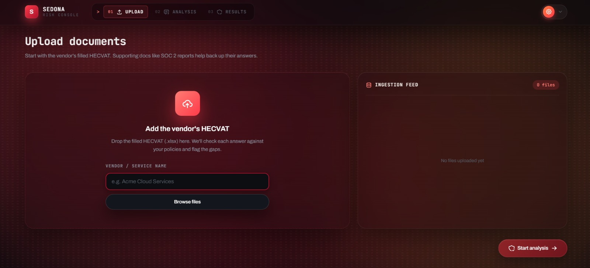
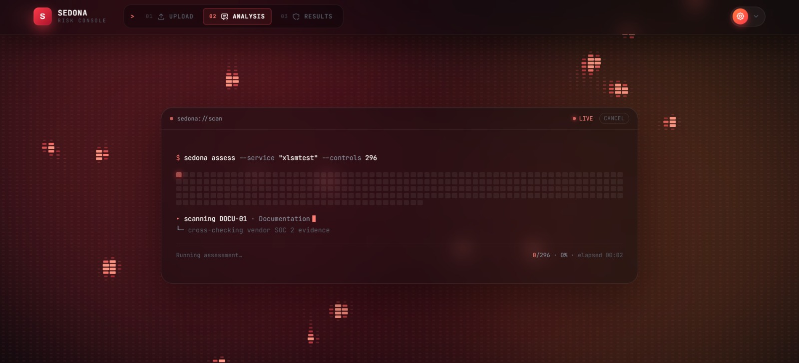
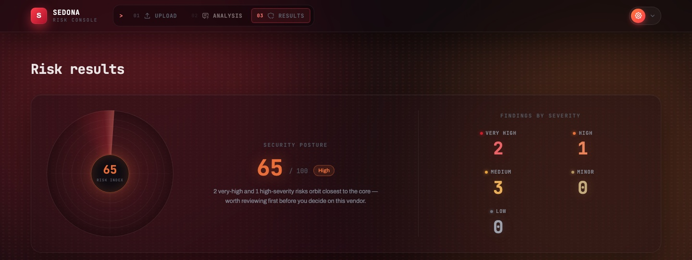

# Sedona

Sedona helps IT teams turn a vendor security questionnaire into a risk assessment they can review and share. Team Aegis at Murdoch University Dubai built it for Murdoch University IT.

## How it works

### Upload the vendor questionnaire

Enter the vendor’s name and upload their completed HECVAT security questionnaire.



### Run the analysis

Sedona checks the vendor’s answers against the policies in its knowledge base. The scan console shows which control it’s checking and how far the assessment has progressed.



Once the scan finishes, you can answer or skip follow-up questions and attach supporting PDFs as needed.

### Review the findings

The results dashboard shows the overall risk score and groups findings by severity so you can see where to start.



Export the assessment as a PDF, PowerPoint presentation, or CSV.

## Platforms

| Platform | Requirements | Default chat model |
| --- | --- | --- |
| Linux | NVIDIA GPU and driver, Node.js 18+, npm, curl | Local `gemma-3-4b-it` through llama.cpp |
| macOS | Apple Silicon, Node.js 18+, npm, Ollama running | `gemma4:31b-cloud` through Ollama |

On macOS, the default chat model sends control text, vendor answers and retrieved policy excerpts
to Ollama Cloud. Document parsing, embeddings and the vector store run locally. A local Ollama
model can be selected with `SEDONA_LLM_MODEL`.

## Setup

1. Install the prerequisites above. For the default macOS model, run `ollama signin` once.
2. Set the first administrator's username, password and display name using the account setup steps
   in the setup guide. Sedona has no default login.
3. From the project folder, run:

   ```bash
   ./start.sh
   ```

4. Open the browser URL printed by the launcher and sign in.
5. Upload approved policy PDFs and `BACKEND/HECVAT_Template.xlsx` on the **Knowledge Base** page.
6. Upload a completed vendor HECVAT, run the assessment, review follow-ups and generate the reports.

The launcher installs missing project dependencies. Linux setup builds the CUDA inference runtime.
macOS setup uses the existing Ollama daemon and pulls the configured models.

## Commands

| Command | Action |
| --- | --- |
| `./start.sh` | Start missing services and reuse running ones |
| `./start.sh --restart-api` | Restart the API after backend or model changes |
| `./start.sh --stop` | Stop this checkout's API and frontend |
| `./start.sh --stop --engines` | Also stop the llama.cpp servers on Linux |
| `./scripts/bootstrap.sh --check` | Check installation components |

Logs are stored in `logs/`. Sedona does not start or stop Ollama.

## Version history

- June 2026: local Gemma inference and local embeddings through llama.cpp.
- August 2026: Linux deployment and installer updates.
- 29 September 2026: macOS support through Ollama, with cloud chat enabled by default.

## Testing

Both macOS and Linux passed our tests. Testing checked application startup, model connectivity
and normal operation with each platform's configured inference backend.

| Platform | Tested setup | Result |
| --- | --- | --- |
| Linux | Ubuntu 20.04 LTS with an NVIDIA GPU and local llama.cpp inference | Passed |
| macOS | macOS 27.0.1 on Apple Silicon, using Ollama 0.34.0 | Passed |

## Docs

- [Installation and first administrator](docs/setup.md)
- [Accounts and assessments](docs/assessments.md)
- [Models and data flow](docs/models.md)
- [Ports, storage and environment variables](docs/configuration.md)
- [Service commands and troubleshooting](docs/operations.md)

Team Aegis (TD01): Aditya Jain, Fahadullah Ahamedullah, Ryan Alex, Sakina Shabbar,
Saleh Khan and Izaan Shumaiz.
